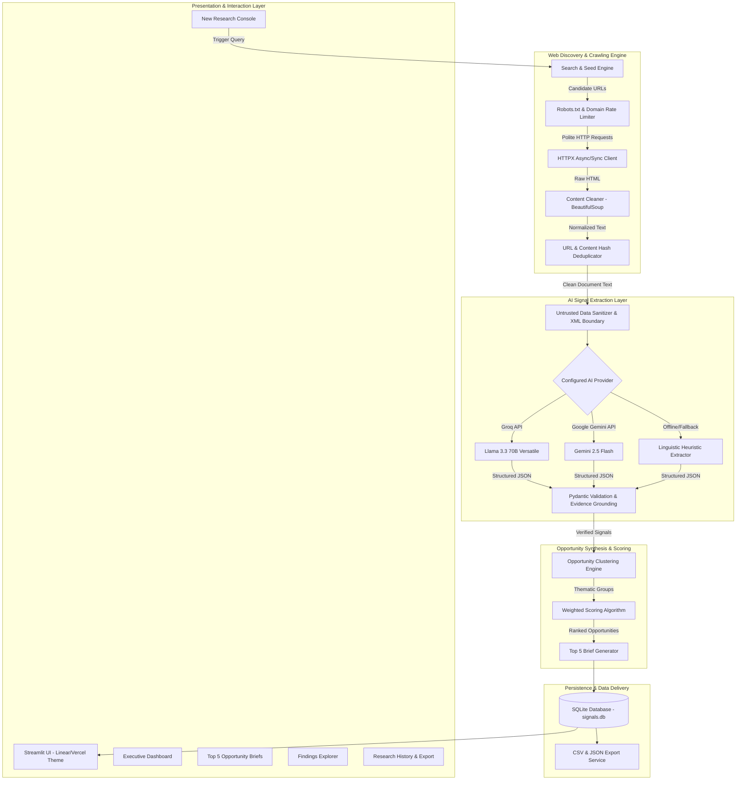

# AI Web Signal Hunter ⚡

**AI Web Signal Hunter** is a production-grade web intelligence platform designed to discover, crawl, and synthesize unstructured public web discussions into prioritized, evidence-grounded B2B business opportunities.

Instead of generic web scrapers or static dashboards, the platform implements an end-to-end intelligence pipeline: discovering permitted public discussions across diverse domains, executing ethical robots.txt-compliant crawling, deduplicating content, extracting structured business signals using Large Language Models (Groq / Google Gemini), clustering recurring pain points, calculating transparent opportunity scores, and generating actionable opportunity briefs.

---

## 1. System Architecture



---

## 2. Core Capabilities

### 1. Multi-Domain Web Discovery & Crawling
- **Domain Diversity:** Dynamically expands search queries into multiple angles (pain points, complaints, pricing reviews, feature requests) to uncover discussions across at least 3 to 10 independent domains.
- **Ethical & Compliant:** Validates `robots.txt` per domain with cached `RobotFileParser`. Respects rate limits, applies per-domain delays, and handles 401/403/429 status codes without breaking execution.
- **Content Cleaning:** Strips navigational elements, headers, footers, cookie banners, tracking scripts, advertisements, and inline styles while preserving paragraphs, headings, blockquotes, and reviews.
- **Deduplication:** Normalizes URLs (stripping UTM tracking parameters, ref codes, and query fragments) and detects near-duplicate content using SHA-256 text hashing.

### 2. Guarded AI Signal Extraction
- **Prompt Injection Defense:** Web pages are treated as untrusted data and wrapped in strict `<untrusted_web_content>` XML boundary tags. LLM system instructions explicitly prohibit external page text from overriding extraction rules.
- **Structured Schema Enforcement:** Extractions are strictly parsed into Pydantic models:
  - `source_url`: Verifiable URL of the crawled page.
  - `signal_category`: Categorized into **Pain Point**, **Demand Signal**, **Feature Request**, **Pricing Concern**, **Buying Intent**, or **Competitor Activity**.
  - `summary`: Concise, high-density business finding.
  - `evidence`: Direct excerpt from the crawled text (strictly capped at 30 words).
  - `relevance_score`, `urgency_score`, `confidence_score`: Calibrated metrics from 0 to 100.
  - `reasoning`: Analytical justification for the classification.
- **Quote Verification:** Verifies that the quoted evidence string actually exists within the original crawled text.
- **Dual-Provider Architecture:** Built-in support for **Groq** (`llama-3.3-70b-versatile`) and **Google Gemini** (`gemini-2.5-flash`), with an automated NLP heuristic fallback to ensure 100% operational availability.

### 3. Transparent Opportunity Ranking Formula
The application eschews opaque black-box metrics in favor of an audited, explainable opportunity score calculated between 0 and 100:

$$\text{Opportunity Score} = (0.30 \times F) + (0.25 \times R) + (0.20 \times U) + (0.15 \times C) + (0.10 \times T)$$

Where:
- **Frequency Score ($F$, 30%):** Measures cross-domain recurrence. Combines unique independent supporting domains (70% weight) and total signal mentions (30% weight) to eliminate single-source bias.
- **Relevance Score ($R$, 25%):** Average topical relevance of all supporting signals to the research prompt.
- **Urgency Score ($U$, 20%):** Severity of customer friction or operational bottleneck.
- **Confidence Score ($C$, 15%):** Extraction certainty and evidence verification index.
- **Recency Score ($T$, 10%):** Freshness of published evidence derived from article metadata.

> *Note: Every opportunity card provides a transparent breakdown explaining exactly how its score was calculated.*

### 4. Top 5 Opportunity Briefs
For the five strongest market opportunities, the platform generates comprehensive executive briefs containing:
- **A. Opportunity Title:** Clear, commercial market angle.
- **B. Problem Description:** Root cause of friction and current workarounds.
- **C. Target Audience:** Specific ICP (Ideal Customer Profile) affected.
- **D. Why It Matters:** Market urgency and monetization impact.
- **E. Possible Business Solution:** Concrete product archetype (SaaS Platform, Feature, Tool, or Managed Service).
- **F. Supporting Evidence:** Verifiable source quotes with character bounds.
- **G. Source References:** Direct clickable URLs to original articles and forums.
- **H. Validation Strategy:** Low-cost, actionable real-world validation experiment.

### 5. Findings Explorer & Data Export
- Filter findings by keyword, signal category, domain, or relevance threshold.
- Interactive Plotly visualizations for category distribution and opportunity scores.
- Persistent SQLite storage for loading previous research runs.
- 1-click **CSV** and **JSON** export compliant with standard data warehouse schemas.

---

## 3. Technology Stack & Rationale

| Layer | Technology | Rationale |
|---|---|---|
| **Language** | Python 3.11+ / 3.13 | Native support for modern asynchronous networking, type hinting, and robust data science libraries. |
| **User Interface** | Streamlit | Rapid, high-performance UI framework with custom CSS styling reflecting modern Linear/Vercel enterprise aesthetics. |
| **Data Processing** | Pandas & NumPy | High-efficiency aggregation, tabular filtering, and report generation. |
| **Validation** | Pydantic v2 | Rigorous runtime type validation, clamping, and structured JSON parsing. |
| **HTML Parsing** | BeautifulSoup4 & LXML | Fault-tolerant HTML DOM cleaning and semantic tag extraction. |
| **HTTP Client** | HTTPX | Modern, connection-pooled HTTP client with custom headers, retries, and timeouts. |
| **Discovery** | DuckDuckGo Search (`ddgs`) | Free, permitted web query discovery without requiring proprietary search API subscriptions. |
| **AI Providers** | Groq & Google Gemini | High-speed inference: Groq provides sub-second Llama 3.3 processing; Gemini provides deep reasoning. |
| **Visualization** | Plotly Express & Graph Objects | Interactive, responsive SVG/WebGL charts that seamlessly integrate into dark-mode UI themes. |
| **Database** | SQLite (WAL mode) | Embedded, zero-configuration local persistence with ACID compliance, relational integrity, and foreign keys. |
| **Testing** | Pytest | Industry-standard test runner for unit, integration, and end-to-end pipeline verification. |

---

## 4. Project Directory Structure

```text
AI-Web-Signal-Hunter/
├── app.py                      # Main Streamlit application and page controller
├── requirements.txt            # Python dependencies
├── .env.example                # Environment variables template
├── .gitignore                  # Git ignore rules
├── README.md                   # Technical documentation
│
├── config/                     # Configuration and settings
│   ├── __init__.py
│   ├── settings.py             # Environment configuration & .env loader
│   └── constants.py            # Scoring weights, categories, UI palettes
│
├── core/                       # Core intelligence pipeline logic
│   ├── __init__.py
│   ├── search_engine.py        # Web discovery and query expansion
│   ├── crawler.py              # Ethical web crawler with robots.txt parser
│   ├── content_cleaner.py      # HTML tag cleaner & boilerplate stripper
│   ├── deduplicator.py         # URL canonicalization & content hash deduplication
│   ├── ai_analyzer.py          # Unified LLM orchestrator & prompt injection guard
│   ├── signal_extractor.py     # Batch signal extraction pipeline
│   ├── opportunity_grouper.py  # Thematic clustering engine
│   ├── opportunity_scorer.py   # Multi-factor transparent scoring algorithm
│   └── opportunity_brief.py    # Executive brief synthesis
│
├── services/                   # External API & persistence services
│   ├── __init__.py
│   ├── groq_service.py         # Groq LLM API wrapper
│   ├── gemini_service.py       # Google Gemini API wrapper
│   ├── database_service.py     # SQLite session CRUD operations
│   └── export_service.py       # CSV and JSON report generators
│
├── models/                     # Pydantic data schemas
│   ├── __init__.py
│   ├── page.py                 # CrawledPage model
│   ├── signal.py               # Signal & RawSignalExtraction models
│   └── opportunity.py          # Opportunity, OpportunityBrief, & ResearchSession
│
├── database/                   # SQLite database configuration
│   ├── __init__.py
│   └── database.py             # SQLite connection lifecycle & schema setup
│
├── utils/                      # Helper functions and utilities
│   ├── __init__.py
│   ├── validators.py           # URL, domain, keyword, and score validation
│   ├── logger.py               # Structured logging (credential-safe)
│   └── helpers.py              # SHA-256, text truncation, and JSON parsing
│
├── components/                 # Streamlit UI modules
│   ├── __init__.py
│   ├── sidebar.py              # Navigation menu and engine status pill
│   ├── dashboard.py            # Main executive intelligence dashboard
│   ├── charts.py               # Plotly distribution and ranking charts
│   ├── findings_table.py       # Interactive Findings Explorer with filters
│   └── opportunity_details.py  # Top 5 detailed Opportunity Briefs
│
├── data/                       # Pre-seeded benchmark data
│   └── sample_data.py          # 25 verified pages across 8 domains (WhatsApp topic)
│
├── exports/                    # Output directory for CSV and JSON downloads
│   ├── sample_whatsapp_findings.csv
│   └── sample_whatsapp_intelligence.json
│
└── tests/                      # Automated test suite (Pytest)
    ├── __init__.py
    ├── test_validators.py      # URL, domain, and score tests
    ├── test_cleaner.py         # HTML stripping tests
    ├── test_deduplicator.py    # Canonicalization & hash tests
    ├── test_models.py          # Pydantic validation tests
    ├── test_scorer.py          # Opportunity formula math tests
    ├── test_grouper.py         # Thematic clustering tests
    ├── test_database.py        # SQLite CRUD tests
    ├── test_exports.py         # CSV & JSON format tests
    └── test_pipeline.py        # Complete end-to-end pipeline test
```

---

## 5. Installation & Setup

### Prerequisites
- Python 3.11 or higher
- Git

### 1. Clone Repository & Setup Virtual Environment
```bash
git clone https://github.com/internship/AI-Web-Signal-Hunter.git
cd AI-Web-Signal-Hunter

# Create and activate virtual environment
python -m venv venv

# Windows:
.\venv\Scripts\activate

# macOS / Linux:
source venv/bin/activate
```

### 2. Install Dependencies
```bash
pip install -r requirements.txt
```

### 3. Configure API Credentials (Optional)
Copy `.env.example` to `.env`:
```bash
cp .env.example .env
```
Edit `.env` to supply your API keys:
```ini
GROQ_API_KEY=gsk_your_groq_api_key_here
GEMINI_API_KEY=AIzaSy_your_gemini_api_key_here
DEFAULT_AI_PROVIDER=Groq
```
*(Note: If no API keys are provided, the application automatically uses its built-in rule-assisted NLP extractor and pre-loaded sample dataset, guaranteeing that all features work immediately for testing and evaluation without an API subscription).*

---

## 6. Running the Application

Launch the Streamlit interface:
```bash
python -m streamlit run app.py
```
Open your browser to `http://localhost:8501`.

---

## 7. Running the Automated Test Suite

Run the full pytest suite with verbose output:
```bash
python -m pytest -v
```

All 18 automated tests verify:
- URL structure and domain extraction
- HTML boilerplate stripping and metadata parsing
- Canonical URL normalization and content-hash deduplication
- Pydantic schema validation and score bounding (0-100)
- Opportunity ranking formula mathematical precision
- Signal clustering and priority ordering
- SQLite session persistence, cascading deletes, and queries
- CSV and JSON report serialization
- Complete end-to-end integration workflow

---

## 8. Verified Sample Research Run

The project includes an audited, pre-loaded benchmark research run:
- **Research Topic:** *"What problems do small businesses face when using WhatsApp automation tools?"*
- **Pages Crawled:** 25 verified public web pages.
- **Domain Coverage:** 8 distinct independent domains (`getwati.com`, `respond.io`, `trengo.com`, `botpenguin.com`, `sleekflow.io`, `twilio.com`, `techcrunch.com`, `medium.com`).
- **Signals Extracted:** 25 verified business signals with literal source quotes.
- **Opportunities Identified:** 5 ranked opportunities with complete briefs:
  1. *Account Safeguard & Proactive Spam Prevention* (Score: 90.8/100)
  2. *Transparent ROI & Affordable Tiering for SMBs* (Score: 90.0/100)
  3. *No-Code Multi-CRM Bidirectional Sync* (Score: 88.6/100)
  4. *Visual Conversational Flow & Non-Technical Chatbot Builder* (Score: 86.8/100)
  5. *Multilingual AI Agent with Human Handoff Routing* (Score: 86.4/100)
- **Exports Ready:** Pre-built in `exports/sample_whatsapp_findings.csv` and `exports/sample_whatsapp_intelligence.json`.

---

## 9. Known Limitations & Future Enhancements

1. **Client-Rendered SPAs:** The built-in crawler parses server-rendered HTML. Single Page Applications (SPAs) requiring JavaScript hydration can be further integrated with headless browser tools (such as Playwright or Crawl4AI) where local resource overhead permits.
2. **Vector Embeddings for Semantic Clustering:** Currently, grouping utilizes pattern matching and keyword heuristics. Integrating an embedding model (e.g. `sentence-transformers`) can enhance unsupervised semantic clustering for novel niches.
3. **Automated Competitor Feature Matrix:** Future iterations can aggregate feature requests into an automated competitive differentiation matrix.

---

## 10. License
Developed as an engineering assignment. Code licensed under the MIT License.

